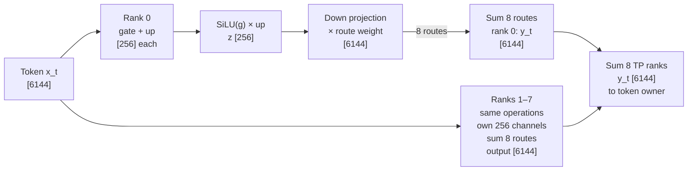
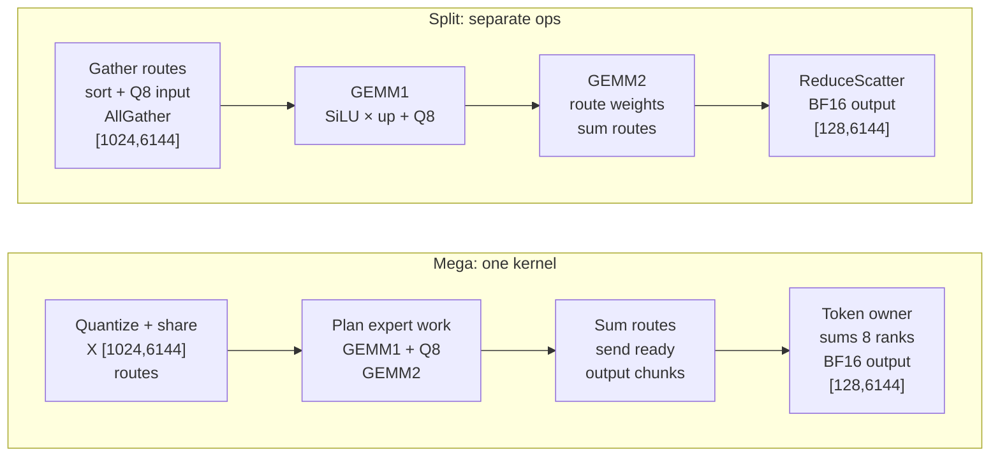
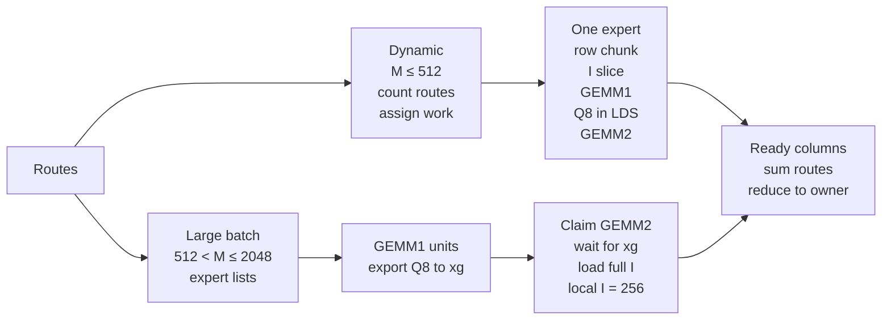
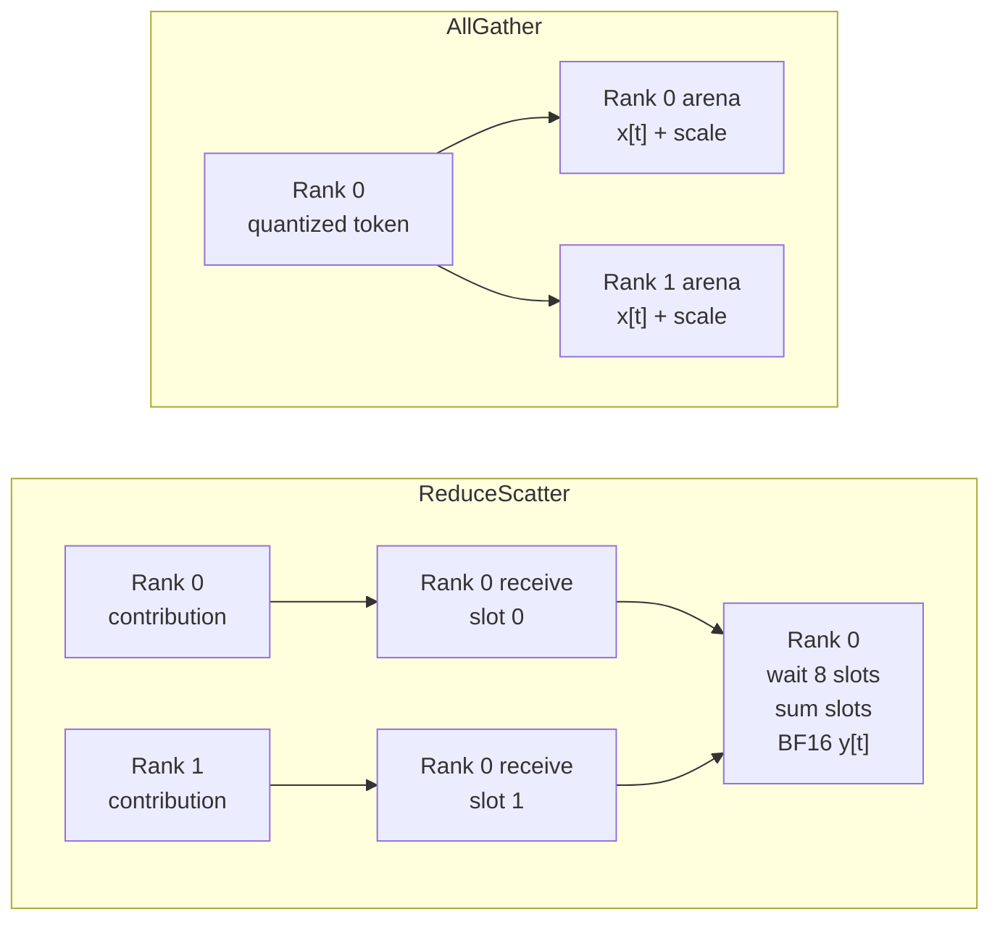

# MegaMoE TP8: math, tensors, and scheduling

## 1. Why a mega kernel?

A **mega kernel** combines several GPU operations into one launch. MegaMoE TP
fuses activation quantization, route planning, two expert GEMMs, and
cross-GPU communication. The router supplies selected expert IDs and weights.

MoE creates uneven expert workloads, and tensor parallelism adds communication.
The split implementation runs separate kernels and collectives. Mega keeps
workgroups resident, coordinating data movement and computation inside one
**persistent kernel**. The motivation is fewer launches and overlap: process
ready data while other data is moving.

This tutorial follows **MiMo A8W4 on gfx950, TP8, `ag_rs`**: FP8 activations,
MXFP4 weights, and tokens distributed across ranks at both input and output.

## 2. One example, one equation

Use `R=8` TP ranks (one GPU per rank), `M=1024` global tokens, `m=M/R=128` local tokens,
`H=6144` hidden channels, `I_global=2048` intermediate channels,
`I=I_global/R=256` channels per rank, `E=384` experts, and `K=8` routes per token.

Every rank holds **all 384 experts**, each with its intermediate-channel slice.
Hidden channels are complete on every rank. For example,
rank 0 owns intermediate channels 0–255 and rank 1 owns 256–511.

For token `t`, route `j` selects expert `e=e[t,j]` with weight $\alpha_{t,j}$.
Follow one token through the logical, dequantized computation:



The gate/up weights are `[256,6144]` each; down weights are `[6144,256]`.
For this bias-free layer, the graph corresponds to:

$$
g_{t,j}^{(r)}=x_t(W_{g,e}^{(r)})^T,\quad
u_{t,j}^{(r)}=x_t(W_{u,e}^{(r)})^T,\quad
z_{t,j}^{(r)}=\mathrm{SiLU}(g_{t,j}^{(r)})\odot u_{t,j}^{(r)}
$$

$$
y_t^{(r)}=\sum_{j=0}^{K-1}\alpha_{t,j}\,
z_{t,j}^{(r)}(W_{2,e}^{(r)})^T,\qquad
y_t=\sum_{r=0}^{R-1}y_t^{(r)}
$$

SiLU is `g * sigmoid(g)`; $\odot$ means elementwise multiplication.
`W_g/W_u` together form `W1`. Quantization approximates these equations.

| Tensor on one rank                 | Logical shape                | Example / representation                      |
| ---------------------------------- | ---------------------------- | --------------------------------------------- |
| Local input `X_r`                | `[m,H]`                    | `[128,6144]`, BF16                          |
| Local IDs / route weights          | `[m,K]` each               | `[128,8]`, INT32 / FP32                     |
| Gathered activation codes / scales | `[M,H]` / `[M,H/32]`     | `[1024,6144]` / `[1024,192]`, FP8 / E8M0  |
| Combined gate/up weight `W1_r`   | `[E,2I,H]`                 | `[384,512,6144]` logical MXFP4              |
| Down weight `W2_r`               | `[E,H,I]`                  | `[384,6144,256]` logical MXFP4              |
| Activated routes `Z_r` / scales  | `[M,K,I]` / `[M,K,I/32]` | `[1024,8,256]` / `[1024,8,8]`, FP8 / E8M0 |
| Rank contribution `Y_r`          | `[M,H]`                    | `[1024,6144]`; may be processed in chunks   |
| Final local output                 | `[m,H]`                    | `[128,6144]`, BF16                          |

MX formats share one power-of-two **E8M0 scale per 32 values**. MXFP4 packs
two values per byte: unshuffled `W1` bytes are `[384,512,3072]` with scales
`[384,512,192]`; `W2` bytes are `[384,6144,128]` with scales `[384,6144,8]`.
Shuffling rearranges values for GPU matrix instructions. The table gives
mathematical shapes; route storage may be reordered, padded, or tiled.

There are `M*K=8192` token–expert routes **on each TP rank**: TP splits channels.
AllGather makes every token available to every weight slice.
ReduceScatter returns rows `[r*m:(r+1)*m]` to their original owner.

## 3. Follow the same tensors through split and Mega

`Q8` means FP8 quantization with group-32 E8M0 scales: each group is
approximated by `scale × FP8 codes`. Both paths use identical input and weights.



Both begin and end with `[128,6144]` local BF16 tokens. Mega's communication
workers progress alongside compute, moving input and output chunks as needed.

Split sorting groups routes into expert row tiles. Mega builds that expert
work plan internally. For expert `e` with `R_e` routes, the two multiplications
are logically `[R_e,H] × [H,2I]` and `[R_e,I] × [I,H]`.
Uniform routing averages `8192/384 ≈ 21.3` rows per expert; hot routing sends
1024 rows to each of eight experts. Same useful arithmetic, different tile
utilization and work distribution.

## 4. How Mega schedules the work

On the measured 256-CU GPU, Mega launches **256 CTAs**. A CTA is a GPU
workgroup with 512 threads: four 64-thread waves compute, one sends activation
data and polls progress, one loads operands, and two help communication.
Compute waves also help communication after finishing their assigned work.
**LDS** is fast shared memory inside one CTA.



**Dynamic:** the plan adapts to the current routing, then assigns unit ranges
to CTAs. Each unit runs GEMM1 and GEMM2 consecutively, using its intermediate
in LDS. Splitting `I` into smaller pieces creates more work units but requires
summing their output partials.

**Large batch (LB):** GEMM1 writes quantized intermediates to the device buffer
`xg`. GEMM2 units cover an expert row chunk and an output-column group, using
the **full local `I`**. Free CTAs claim these units, improving work distribution
at the cost of intermediate stores/loads. A CTA can enter GEMM2 while others
finish GEMM1; readiness counters protect each row chunk.

These are current **MiMo defaults**, with support through **M2048**.
LB uses 32-row tiles at M1024 and 64-row tiles at M2048
(`rows = 16 * lb_mt`); `lb_q` groups output-column chunks.
`lb_min=0` forces dynamic for this qualified MiMo shape.

## 5. Communication: symmetric memory as shared mailboxes

Each GPU allocates an arena with the **same buffer layout and offsets**:
activation codes/scales, routes, receive slots, and readiness flags.
HIP IPC maps each arena into the other ranks once during setup.
The kernel can then address a peer buffer as
`peer_base[rank] + buffer_offset`. Base addresses may differ; each GPU's
memory stays physically separate.

Think of identical mailboxes on every GPU. After data stores complete, the
sender publishes readiness; the peer waits before reading.
For a token owned by rank 0, two of the eight ranks look like:



**AllGather** pushes activation codes, scales, and routes to all arenas.
**ReduceScatter** sends each rank's weighted route sum to a separate
sender slot on the token owner; the owner sums all eight contributions.
Its active receive data has logical shape `[8,128,6144]`; allocation capacity
uses `max_local_tokens` per sender.

Completion flags carry a launch epoch, so an earlier forward cannot satisfy
the current wait. Low-latency variants embed readiness in packets.
Ready chunks progress **inside the same kernel** while others compute,
without a separate collective launch. Data still travels over GPU links.
The `xg` GEMM intermediate is rank-local, outside this peer arena.

## 6. What makes the comparison consistent?

| Match or record                                | Why it matters                                                                                                                             |
| ---------------------------------------------- | ------------------------------------------------------------------------------------------------------------------------------------------ |
| Same tokens, routes, and raw quantized weights | Both candidates compute the same synthetic layer                                                                                           |
| Correct weight layout for each path            | Mega uses `shuffle_weight(16,16)` + `e8m0_shuffle`; split uses `shuffle_weight_a16w4` / `shuffle_scale_a16w4`, gate/up interleaved |
| Intermediate rounding                          | Mega rounds activated GEMM1 output to BF16 before Q8; selected split GEMM1 quantizes its FP32 activation directly                          |
| Output communication                           | Split sends BF16 rank partials; Mega selects FP8 or BF16 with `comm_dtype`. Final output is BF16 in both cases                           |
| Whole-forward timing                           | Include route preparation, quantization, both GEMMs, and collectives; prepare weights and compile outside timing                           |

`act_dtype="fp8"` controls activation/intermediate quantization.
`comm_dtype="bf16"` changes output communication; the input remains MXFP8.
The benchmark checks matching references and records error against a common reference.
BF16 communication gives a closer comparison; intermediate rounding still differs.

Saved random-route results on gfx950 TP8, in microseconds:

| Global M | Split BF16 communication | Mega FP8 communication | Mega BF16 communication |
| -------: | -----------------------: | ---------------------: | ----------------------: |
|      256 |                  240.623 |                234.709 |                 269.831 |
|      512 |                  286.885 |                271.156 |                 272.079 |
|     1024 |                  441.880 |                303.050 |                 311.209 |
|     2048 |                  512.236 |                385.328 |                 430.977 |

These average seeds 123/124; each measurement is the median of three
slowest-rank CUDA-graph rounds. Across random/balanced/hot routes and both
communication types, the comparison passed 48/48 cases.
At M2048, split uses [PR #5851](https://github.com/ROCm/aiter/pull/5851)'s
FlyDSL GEMM1 + BF16 OPUS route-output GEMM2; smaller M use qualified 16-row
configs. FP8 speedups include a communication-precision difference.
These synthetic layer results do not establish checkpoint-level accuracy.
Overlapping profiler intervals cannot be added to reconstruct layer latency.

## 7. Reproduce and find the code

Run from the AITER repository root:

```bash
HSA_ENABLE_IPC_MODE_LEGACY=1 PYTHONPATH=. \
torchrun --standalone --nproc_per_node=8 \
  op_tests/multigpu_tests/bench_mega_moe_tp.py \
  --tokens 256 512 1024 2048 --routes random balanced hot \
  --seeds 123 124 --comm-dtypes fp8 bf16 \
  --output-dir results/mimo-a8w4-extended/tutorial-repro
```

`bench_mega_moe_tp.py` measures split versus Mega; `test_mega_moe_tp.py`
validates Mega against PyTorch and exercises lifecycle cases.
For the example, pass `inter_dim=256` and `prepare([128])`: both API values
are local. Each forward runs one kernel per rank. All ranks call in the same
order with equal local token counts. Prepare before graph capture; the kernel requires
the whole GPU.

Code: [API](aiter/ops/flydsl/mega_moe_tp.py),
[host/config selection and arena](aiter/ops/flydsl/kernels/mega_moe_tp/mega_moe_tp.py),
[wave roles](aiter/ops/flydsl/kernels/mega_moe_tp/mega_moe_tp_kernel.py),
[schedule.py](aiter/ops/flydsl/kernels/mega_moe_tp/schedule.py),
[gemm.py](aiter/ops/flydsl/kernels/mega_moe_tp/gemm.py), and
[communication.py](aiter/ops/flydsl/kernels/mega_moe_tp/communication.py).
Benchmark with [Split](op_tests/multigpu_tests/bench_mega_moe_tp.py).
